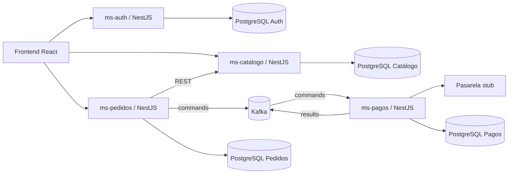

# C4 — contenedores

Cada servicio tiene su almacén y despliegue propio. `ms-auth` es propietario de usuarios y sesiones; `ms-pedidos` es el coordinador de la saga; Kafka transporta la solicitud y el resultado del cobro; `ms-catalogo` es el propietario del stock y `ms-pagos` el propietario del cobro.
