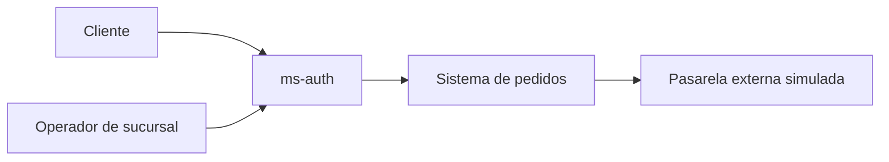

# C4 — contexto

El sistema permite autenticarse, consultar catálogo, crear pedidos, reservar existencias y autorizar cobros. `ms-auth` gestiona credenciales y emite JWT; cliente y sucursal usan roles distintos. La pasarela es una dependencia externa que puede fallar; el sistema debe conservar consistencia mediante compensación.
