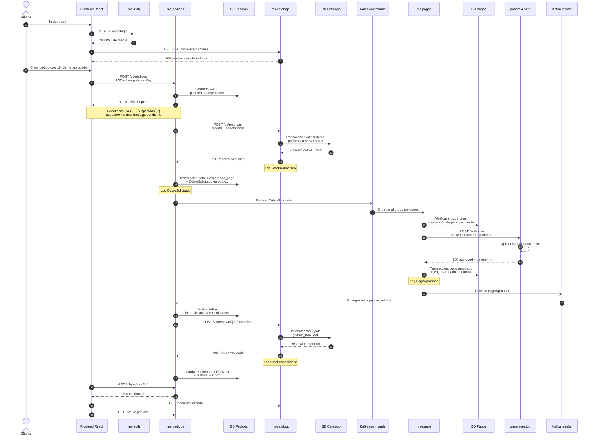
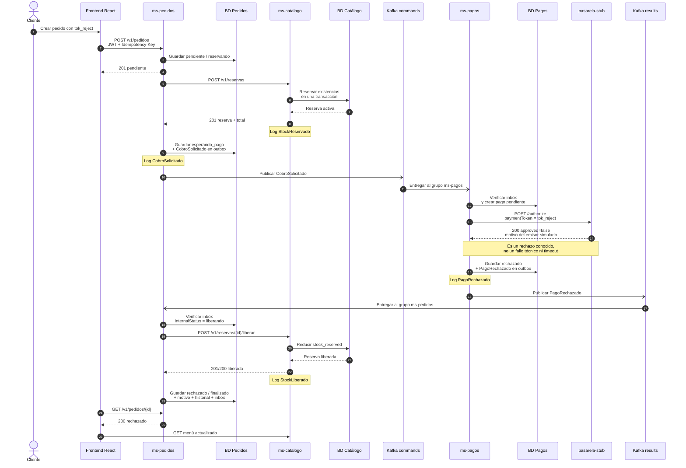
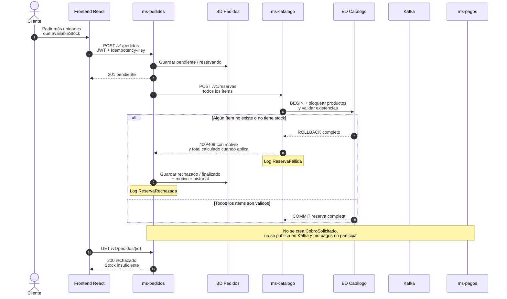
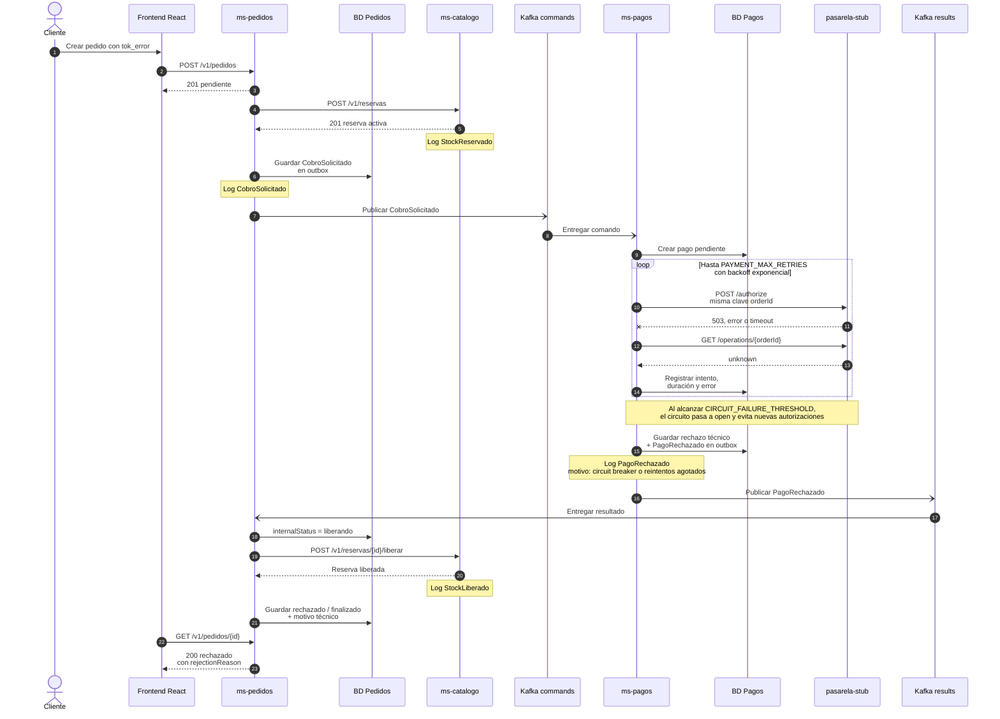
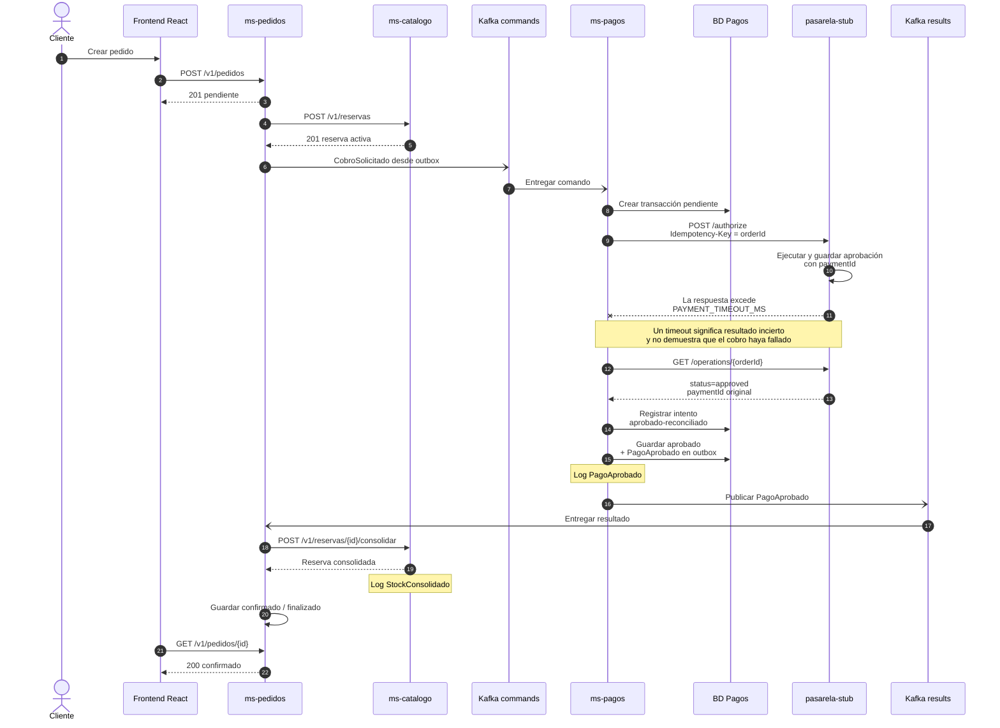
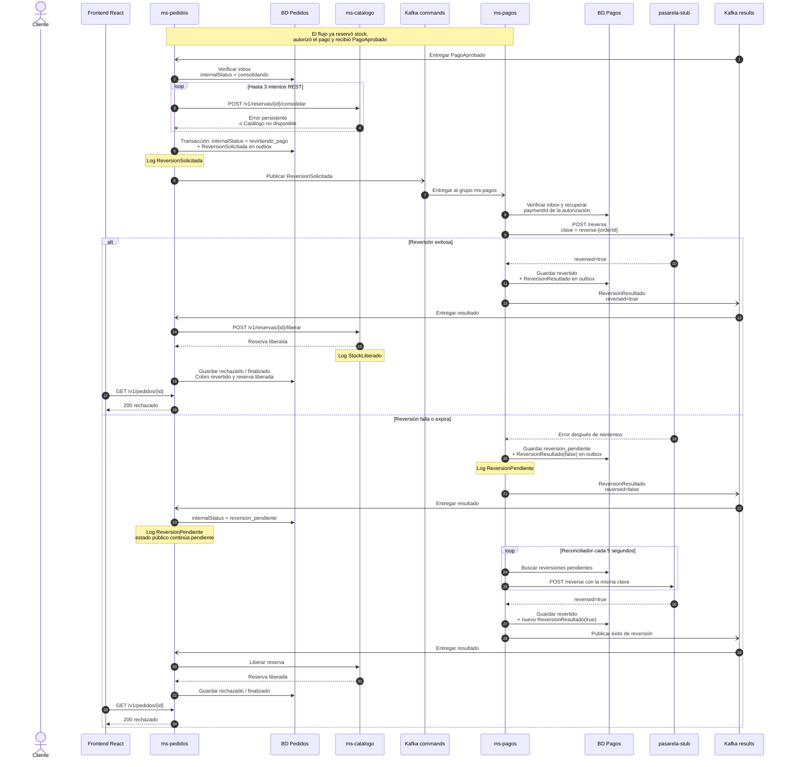
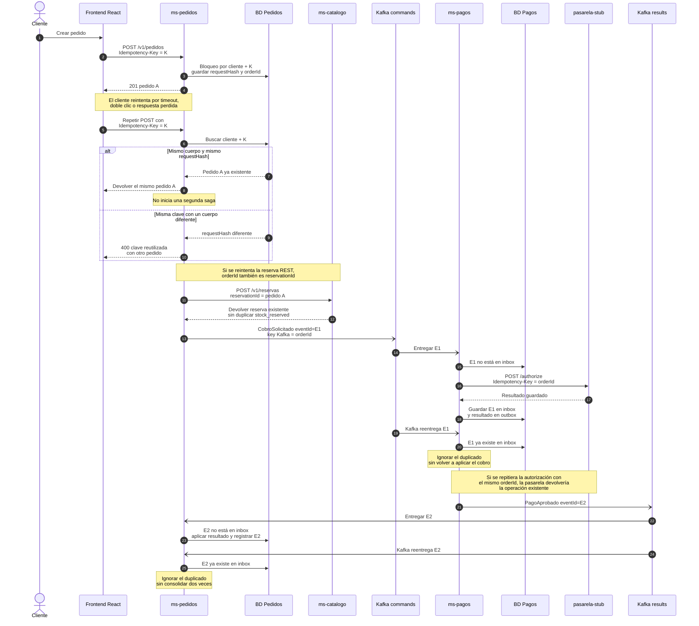

# Secuencias de la saga de pedidos

Estos diagramas representan el comportamiento del código actual. El sistema combina operaciones **REST/HTTP síncronas** con eventos **Kafka asíncronos**. Cada microservicio conserva sus propios datos y las integraciones importantes son idempotentes.

El estado público de un pedido es `pendiente`, `confirmado` o `rechazado`. Los pasos internos de la saga usan estados como `reservando`, `esperando_pago`, `consolidando`, `liberando`, `revirtiendo_pago`, `reversion_pendiente` y `finalizado`.

Para exponer los escenarios paso a paso y en pantalla completa, abrir [presentacion-flujos.html](presentacion-flujos.html). Los valores de stock de esa vista son ilustrativos: total inicial 20 y pedido de una unidad.

## Cómo leer los diagramas

- `->>` representa una solicitud síncrona: el emisor espera una respuesta.
- `-->>` representa la respuesta de una solicitud síncrona.
- `-)` representa publicación o entrega asíncrona mediante Kafka.
- `payments.commands.v1` transporta comandos desde `ms-pedidos` hacia `ms-pagos`.
- `payments.results.v1` transporta resultados desde `ms-pagos` hacia `ms-pedidos`.
- `outbox` guarda eventos pendientes de publicación junto con el cambio de negocio.
- `inbox` o la tabla de procesados evita aplicar dos veces el mismo `eventId`.
- El mismo `correlationId` acompaña todo el flujo y permite relacionar logs entre servicios.

| Componente | Publica | Consume |
|---|---|---|
| `ms-pedidos` | `CobroSolicitado`, `ReversionSolicitada` | `PagoAprobado`, `PagoRechazado`, `ReversionResultado` |
| `ms-pagos` | `PagoAprobado`, `PagoRechazado`, `ReversionResultado` | `CobroSolicitado`, `ReversionSolicitada` |
| `ms-catalogo` | No usa Kafka | No usa Kafka |
| `ms-auth` | No usa Kafka | No usa Kafka |
| `pasarela-stub` | No usa Kafka | No usa Kafka |

`kafka-init` únicamente crea ambos tópicos y termina correctamente. La lógica de publicación y consumo vive dentro de `ms-pedidos` y `ms-pagos`, no dentro de Kafka.

## 1. Pedido aprobado y confirmado

**Sincronía y resultado:** reservar y consolidar stock son llamadas REST síncronas. El cobro y su resultado viajan asíncronamente por Kafka. El `POST /v1/pedidos` no espera a la pasarela: devuelve el pedido `pendiente` y el frontend observa el resultado mediante polling. La aprobación del cobro por sí sola no confirma el pedido; también debe consolidarse la reserva.

**Stock:** reservar aumenta `stockReserved` y reduce `availableStock`, pero mantiene `stockTotal`. Consolidar descuenta la cantidad tanto de `stockTotal` como de `stockReserved`.

## 2. Pago rechazado y compensación de stock

**Sincronía y resultado:** la reserva y la liberación son REST síncronos; `CobroSolicitado` y `PagoRechazado` son eventos Kafka asíncronos. Como la reserva nunca se consolidó, liberar solo reduce `stockReserved`; `stockTotal` no cambia y `availableStock` vuelve al valor anterior.

## 3. Stock insuficiente: rechazo antes del pago

**Sincronía y resultado:** este escenario termina enteramente mediante REST. La reserva de varios ítems es atómica: si uno falla, Catálogo revierte toda la transacción y no queda stock parcialmente reservado. El pedido queda `rechazado/finalizado` sin intentar ningún cobro.

## 4. Error técnico de pasarela y circuit breaker

**Sincronía y resultado:** cada intento hacia la pasarela es HTTP síncrono y tiene timeout; el comando y el resultado siguen siendo Kafka asíncronos. Los valores efectivos se configuran con `PAYMENT_MAX_RETRIES`, `PAYMENT_BACKOFF_MS`, `CIRCUIT_FAILURE_THRESHOLD`, `CIRCUIT_OPEN_MS` y `PAYMENT_TIMEOUT_MS`. En modo determinista, `tok_error` fuerza el error técnico.

## 5. Autorización ejecutada pero respuesta perdida

**Sincronía y resultado:** la consulta `GET /operations/{orderId}` resuelve la incertidumbre antes de repetir la autorización. Si fuera necesario repetirla, se usaría la misma clave idempotente y el stub devolvería la operación ya registrada, evitando un doble cobro. Se simula con `STUB_EXECUTE_THEN_TIMEOUT_RATE=1`.

## 6. Pago aprobado, consolidación fallida y reversión

**Sincronía y resultado:** la consolidación y la reversión contra la pasarela son HTTP síncronos con reintentos. `ReversionSolicitada` y `ReversionResultado` viajan asíncronamente por Kafka. Mientras no exista confirmación de la reversión, el pedido permanece públicamente `pendiente` y usa `reversion_pendiente` como estado interno; no se marca rechazado antes de recuperar el dinero y liberar la reserva.

Este fallo exacto de consolidación está cubierto por pruebas, pero no existe un token de pago que lo fuerce por sí solo: requiere simular indisponibilidad o error de Catálogo al consolidar.

## 7. Solicitudes y mensajes duplicados

**Capas de idempotencia:**

1. `Idempotency-Key` identifica la intención HTTP del cliente.
2. `requestHash` impide reutilizar esa clave con un cuerpo diferente.
3. `orderId` identifica la reserva en Catálogo y la autorización en la pasarela.
4. `eventId` identifica una entrega Kafka y permite descartarla si ya está en inbox.
5. La clave Kafka es `orderId`, por lo que los eventos del mismo pedido se enrutan de forma consistente.

## Resumen de sincronía

| Integración | Tipo | Quién espera | Propósito |
|---|---|---|---|
| Frontend → `ms-auth` | REST síncrono | Frontend | Login, registro y sesión |
| Frontend → `ms-catalogo` | REST síncrono | Frontend | Sucursales, menú y mantenimiento |
| Frontend → `ms-pedidos` | REST síncrono | Frontend | Crear, listar y consultar pedidos |
| `ms-pedidos` → `ms-catalogo` | REST síncrono | `ms-pedidos` | Reservar, consolidar y liberar stock |
| `ms-pagos` → `pasarela-stub` | HTTP síncrono | `ms-pagos` | Autorizar, consultar y revertir pagos |
| `ms-pedidos` → Kafka → `ms-pagos` | Asíncrono | No hay conexión HTTP abierta | Comandos de cobro y reversión |
| `ms-pagos` → Kafka → `ms-pedidos` | Asíncrono | No hay conexión HTTP abierta | Resultados de pago y reversión |
| Frontend → `GET /v1/pedidos/{id}` | REST síncrono repetido | Frontend en cada consulta | Polling cada 800 ms hasta estado final |

La combinación permite responder rápidamente al cliente, desacoplar la parte lenta o inestable del pago y conservar compensaciones explícitas cuando una etapa posterior falla.
